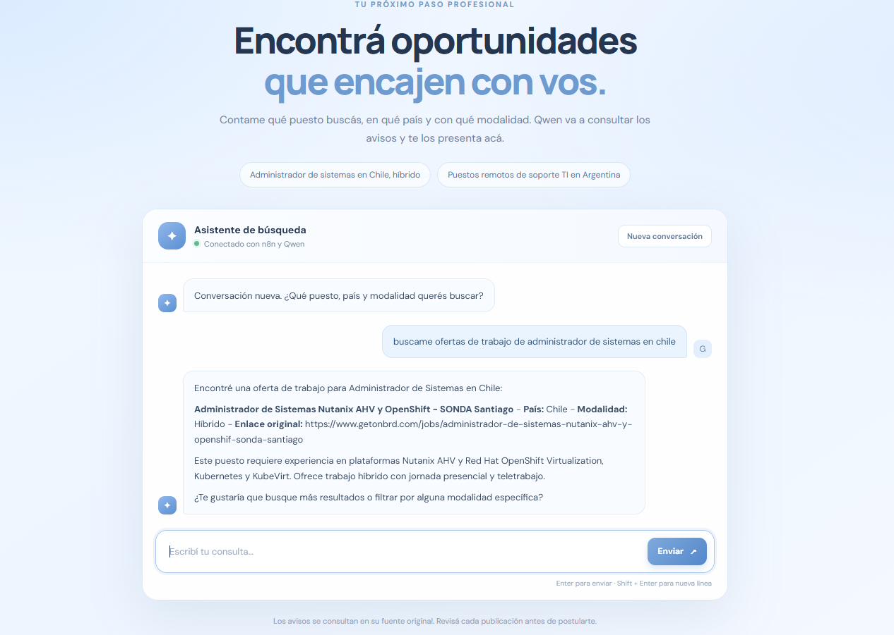
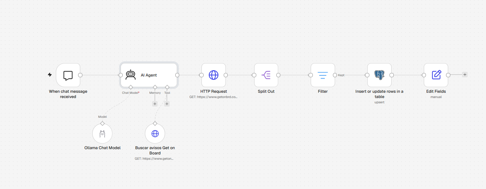

# Laboratorio de búsqueda laboral con n8n

**Buscador de ofertas laborales** es un buscador sencillo que corre con modelos locales a través de Ollama. n8n coordina las consultas a la API pública de Get on Board, y PostgreSQL puede conservar los avisos procesados.

La API pública de Get on Board es gratuita y no requiere autenticación ni API key. Este proyecto usa el endpoint público de búsqueda; no necesita credenciales de Get on Board.





## Componentes

- **n8n**: orquesta el flujo y expone el Chat Trigger.
- **Ollama**: sirve el modelo local configurado en n8n (por ejemplo, `qwen3.5:9b`).
- **PostgreSQL**: base de datos del flujo y almacenamiento de avisos, según la configuración del workflow.
- **Chat web**: interfaz Flask que reenvía mensajes a n8n y muestra las respuestas en Markdown.
- **Get on Board**: fuente de avisos usada por el workflow de ejemplo.

## Requisitos

- Docker Desktop con Docker Compose.
- Git, si vas a clonar el repositorio.
- Memoria y espacio disponibles para descargar y ejecutar el modelo elegido en Ollama.

## Inicio rápido

1. Copiá `.env.example` a `.env`.

   ```powershell
   Copy-Item .env.example .env
   ```

2. Editá `.env`: definí una contraseña propia para PostgreSQL, una clave larga y aleatoria para `N8N_ENCRYPTION_KEY`, y el identificador real del Chat Trigger en `N8N_CHAT_WEBHOOK_URL`. No publiques `.env`.
3. Iniciá los servicios desde esta carpeta:

   ```powershell
   docker compose up -d --build
   ```

4. Abrí n8n en <http://localhost:5678> y la interfaz en <http://localhost:8081>.
5. Importá `workflows/buscador-ofertas-laborales.json`, configurá tus credenciales de Ollama y PostgreSQL, y publicá el Chat Trigger.
6. Descargá el modelo que elegiste en Ollama:

   ```powershell
   docker compose exec ollama ollama pull qwen3.5:9b
   ```

   En la credencial de Ollama de n8n, usá `http://ollama:11434` como dirección desde la red Docker.

## Configuración del Chat Trigger

En el nodo **Chat Trigger**, habilitá el chat público y seleccioná **Embedded Chat**. Configurá la respuesta para que devuelva la salida final del flujo. Copiá la URL de producción del Chat Trigger a `N8N_CHAT_WEBHOOK_URL`; desde el contenedor `chat-web`, el host debe ser `n8n`, no `localhost`.

El archivo `.env.example` contiene la URL de ejemplo con un identificador de marcador. Reemplazalo por el identificador del webhook de tu propia instancia.

## Workflow de ejemplo

El workflow de ejemplo está exportado en `workflows/`. Al importarlo en tu instancia, volvé a asignar las credenciales de Ollama y PostgreSQL. El export trae un ID de ejemplo para el Chat Trigger; copiá su Chat URL a `.env`.

Antes de compartir un workflow:

- quitá datos de credenciales y encabezados de autorización;
- sustituí IDs de webhooks, URLs locales o identificadores personales por marcadores documentados;
- revisá que no haya ejecuciones fijadas con conversaciones, datos personales o avisos privados;
- documentá qué credenciales debe crear cada persona que lo importe.

No exportes la base de datos de n8n ni sus volúmenes como parte del repositorio.

## Comandos útiles

```powershell
docker compose ps
docker compose logs -f n8n
docker compose logs -f chat-web
docker compose down
```

Los datos persisten en volúmenes Docker. `docker compose down -v` también los elimina; usalo solo cuando quieras borrar el estado local del laboratorio.

## Privacidad y seguridad

- `.env` está excluido de Git; publicá solo `.env.example` con marcadores.
- No guardes contraseñas, tokens, credenciales ni datos de conversaciones en capturas o exports.
- Las publicaciones laborales provienen de un servicio externo y pueden cambiar o desaparecer.
- Este proyecto es un laboratorio educativo; revisá el aviso original antes de postularte.

## Uso de la API de Get on Board

El proyecto consulta la API pública de Get on Board, que es gratuita y no requiere autenticación. Respetá sus condiciones de uso: atribuÍ la fuente a Get on Board, enlazá cada aviso a su publicación original y enviá allí a las personas que quieran postularse. Las condiciones también indican mostrar los datos sin alterarlos, mantenerlos actualizados al menos cada 24 horas, no revenderlos y no usarlos para entrenar modelos. Revisá las [condiciones y documentación oficial](https://www.getonbrd.com/api-doc) antes de adaptar o republicar los datos.

## Capturas de pantalla

Las capturas incluidas muestran la interfaz de chat y la vista general del workflow. Se revisaron para evitar correos, credenciales y URLs/IDs privados. Si las reemplazás, verificá que no aparezcan webhooks completos, claves, datos personales ni historial de ejecución.

## Licencia

Este proyecto se distribuye bajo la licencia [MIT](LICENSE).
